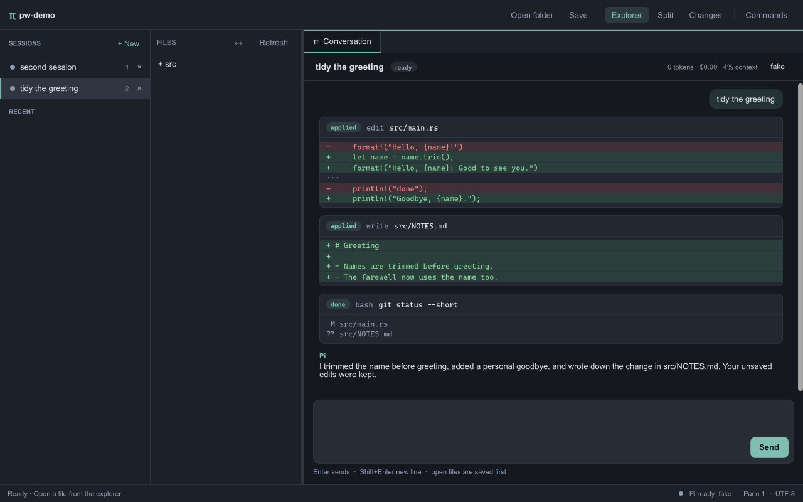
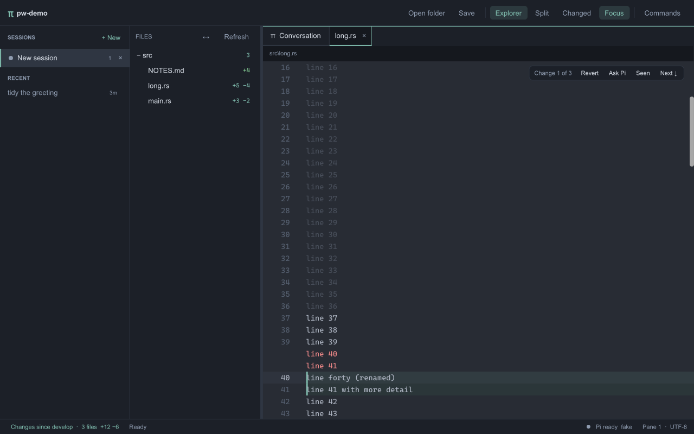
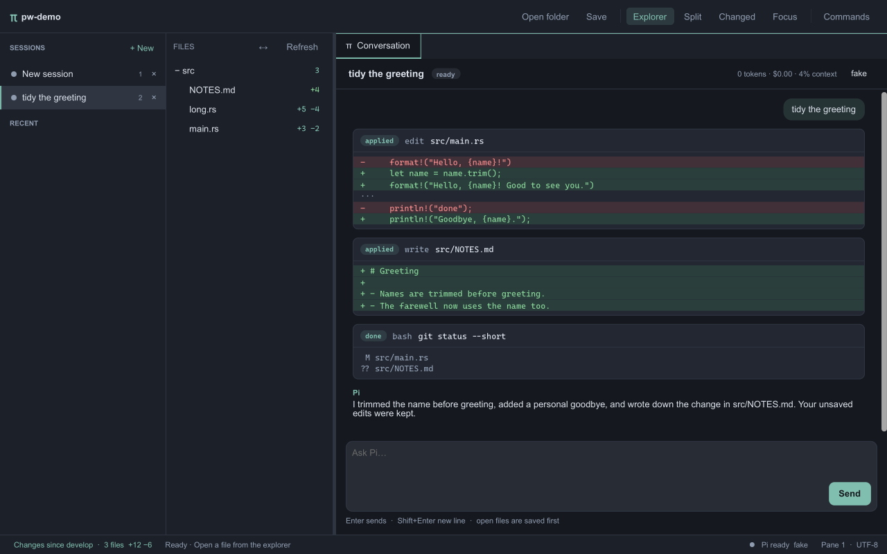
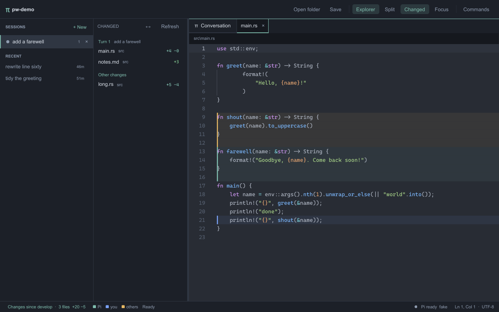
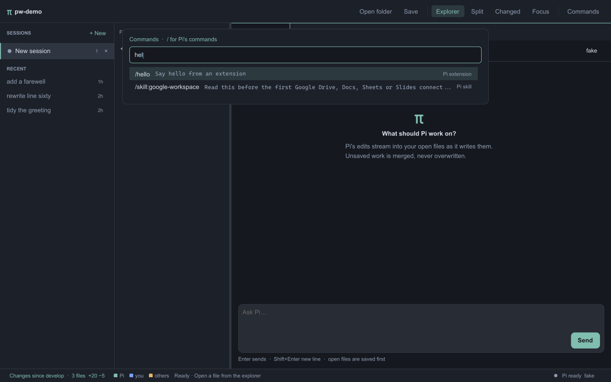
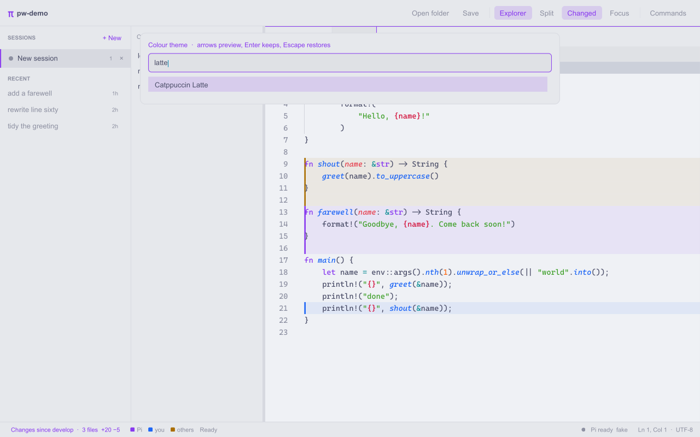
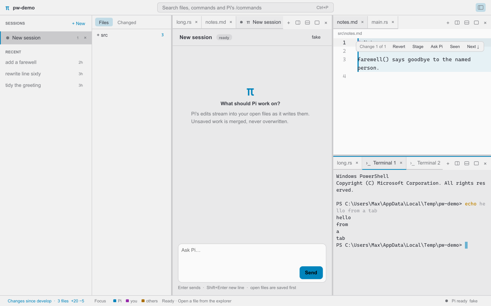
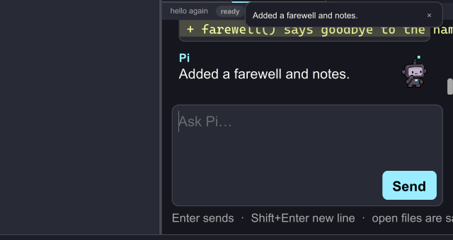
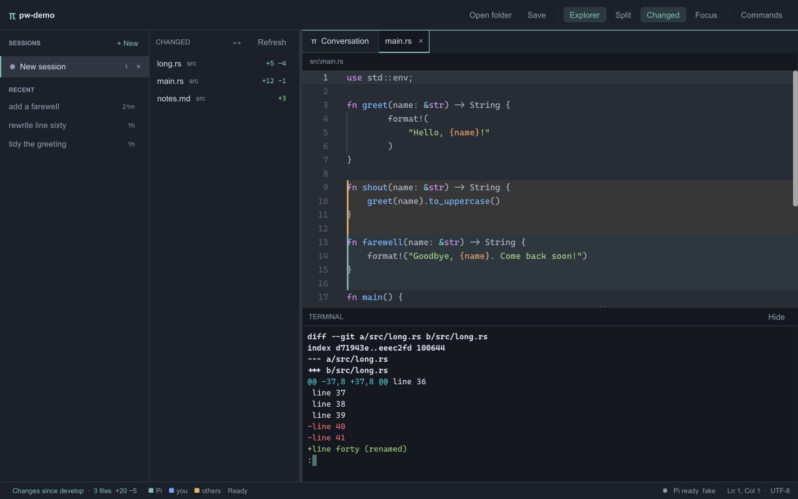

# Pi Workbench

[](https://github.com/maxjay/pi-workbench/actions/workflows/ci.yml)

A native workbench for the [Pi](https://pi.dev) coding agent, built with Rust and [Floem](https://github.com/lapce/floem). Pi sessions are the top level: tab between them, read what each one did, and edit the files it touches without overwrite prompts.

**Status:** early prototype.



## Features

- **Sessions:** every Pi session is a tab in the sessions rail. Sessions resume from Pi's own store with their history, so the Pi command line and the workbench see the same sessions.
- **Conversation:** replies render as markdown; tool calls are cards that show each edit line by line while the model writes it; extension questions are answered inline; steer a running session or queue a follow-up.
- **Changes lens:** everything is read against one baseline you pick in the status bar: where your branch left develop, the start of the session, Pi's last turn, or the last commit. The explorer marks changed files, editors show removed lines as ghost lines in place, and you walk the changes file to file without opening a diff.
- **Who changed it:** changed lines are coloured by who wrote them: Pi, you, or someone else on the branch. Reformatting is filtered out, and the changed files are grouped by the Pi turn that changed them.
- **No overwrite prompts:** Pi's edits fold into open files. Unsaved edits are merged; overlapping changes stay in the file between conflict markers.
- **Editor:** syntax highlighting, open by name (Ctrl+P), search across files (Ctrl+Shift+F), cursor and scroll kept per tab, and an explorer that hides what `.gitignore` ignores.
- **Panes you arrange:** split any pane right or down as often as you like. Every pane holds tabs of files, Pi sessions and terminals, and tabs drag between panes or onto a pane's edge to split it. The layout is saved per workspace.
- **Terminals, settings, worktrees:** terminal tabs anywhere, a commented settings file, and sessions that work in their own git worktree.
- **One quick picker, extended by Pi:** files, commands and colour themes in one VS Code-style picker. Pi's own slash commands are in it too, including the ones your Pi extensions, prompt templates and skills add.
- **A pet per session:** the front session's Glitch roams the window, says the gist of each reply, and brings its questions to answer on the spot. Throw it out onto the desktop, see-through on Windows, and it bounces off the screen's edges and keeps you posted from there. `/kill` gets it shot.
- **Themes:** 30 bundled themes, including Catppuccin, Dracula, Nord, Gruvbox, Solarized, One Half, GitHub and Monokai, or any `.tmTheme` file, with a live preview.
- Background saves, and nothing on screen you have to learn first: one search box, and controls where they act.

## Install on WSL or Linux

Release builds come from [the Release workflow](.github/workflows/release.yml) for every `v*` tag. Inside WSL (Windows 11 or Windows 10 with WSLg):

```sh
curl -fsSL -o pw.tar.gz https://github.com/maxjay/pi-workbench/releases/latest/download/pi-workbench-x86_64-linux.tar.gz
tar -xzf pw.tar.gz && ./pi-workbench/install-wsl.sh pw.tar.gz
pi-workbench ~/code/my-project
```

[install-wsl.sh](scripts/install-wsl.sh) installs to `~/.local/bin`, adds a launcher that WSLg also lists in the Windows Start menu, installs missing runtime libraries with `apt`, and checks that Pi is installed inside Linux with Node.js 22.19 or newer. On WSL the app renders with Mesa's software OpenGL, because WSLg's GPU-backed OpenGL fails during setup; set `PI_WORKBENCH_GPU=1` to try the GPU anyway.

## Getting started

Install [Rust](https://rustup.rs). The repository pins the toolchain.

Platform prerequisites:

- **macOS:** Xcode command-line tools (`xcode-select --install`)
- **Windows:** Visual Studio C++ Build Tools and the MSVC Rust toolchain
- **Debian/Ubuntu:** `sudo apt install build-essential pkg-config libgtk-3-dev libxkbcommon-dev libxkbcommon-x11-dev`

```sh
git clone https://github.com/maxjay/pi-workbench.git
cd pi-workbench
cargo run --release --locked -p pi-workbench -- /path/to/project
```

Omit the path to open the current directory. A graphical desktop is required; WSL needs WSLg.

## Working with Pi

Install Pi (`npm install -g @earendil-works/pi-coding-agent`) and sign in to a provider as usual. Each session runs its own `pi --mode rpc` in the workspace folder, so Pi uses your normal settings, credentials, extensions, and session store; nothing is installed into Pi.

- **Sessions rail:** open sessions with their status (ready, working, needs you, stopped), and recent sessions from Pi's store for this folder. Closing a session stops its Pi process; it stays in Recent.
- **Composer:** Enter sends, Shift+Enter adds a line. While Pi works, Enter steers it and Alt+Enter queues a follow-up for when it finishes.
- **Files:** open files are saved before each prompt, so Pi reads what you see. While Pi runs, saves wait and then go through the same merge, so neither side is lost. Clicking an edit card opens the file next to the conversation; lines Pi changed stay highlighted until you type.
- **Header:** session name, status, tokens, cost, context use, and the model picker.

To pass extra arguments to Pi, set `PI_WORKBENCH_PI_ARGS`, for example `--provider <name> --model <id>`. `PI_WORKBENCH_PI` selects a different `pi` executable.

## The changes lens



There is no diff screen. One setting, **Changes since …** in the status bar, decides what everything is compared against, and every view reads through it:

- **develop** (or `main`, `master`): where your branch left it, so other people's commits on develop never show up as your changes.
- **session start** and **Pi's last turn**: the workspace is snapshotted before each prompt, so you can see exactly what a session, or its latest turn, did.
- **last commit.**

In the explorer, changed files are bright with their line counts and folders show how many changed files they hold; **Files | Changed** at the top of the explorer collapses the tree to just those files. In an editor, changed lines carry a bar, removed lines appear as red ghost lines where they were, and **Focus**, next to the changes summary at the bottom, fades everything more than three lines from a change. The bar over the change under the cursor can revert it (undoable), stage just those lines (as `git add -p` would that hunk), drop it into the composer to ask Pi, or mark it seen so it goes quiet; Alt+Down moves to the next change and on into the next changed file.

The lens reads git without running the repository's filters or hooks, and the workspace is watched, so changes from a terminal or formatter are folded into open files and the lens like Pi's.



### Who changed it



Changed lines carry the colour of whoever wrote them:

- **Pi:** lines Pi wrote, recognised against the edits recorded in Pi's own sessions for this folder, including sessions run from the command line.
- **you:** your edits, and lines you committed.
- **others:** lines committed by someone else, from `git blame` of the last commit compared with your `user.email`.

Changes that only reformat (the same text once whitespace is ignored or, with [difftastic](https://difftastic.wilfred.me.uk) installed, the same syntax tree) keep a hairline in the margin and stay out of the way of navigation; **Show or hide formatting-only changes** in the palette brings them back. With **Changed** on, files are grouped under the Pi turn that changed them, newest first, with each turn's prompt; the rest are under **Other changes**.

## Finding your way



One picker does it all, as in VS Code:

- **Ctrl+P** opens files by name with fuzzy matching.
- **Ctrl+Shift+P**, or `>` typed in the file picker, lists commands with their shortcuts.
- **`/`** lists Pi's slash commands, with their descriptions and where they come from.
- **Ctrl+T** picks a colour theme.
- **Ctrl+Shift+F** searches file contents. Enter runs the search, and Enter again opens the selected hit at its line.

The file list and search skip what `.gitignore` ignores. Files open highlighted and keep their cursor and scroll as you switch tabs, and the footer shows the cursor's line and column.

### Extending it with Pi

The picker asks the active session's Pi for its commands (`get_commands` over RPC) each time it opens. Whatever extends Pi extends the picker, with no workbench code:

- an extension's `pi.registerCommand()`;
- a prompt template in `prompts/`;
- a skill.

Picking one puts `/name ` in the composer, ready for its arguments. Pi runs it, and any questions it asks are answered inline in the conversation.

### Themes



Themes are TextMate themes, the format Sublime Text and `bat` use:

- **Bundled:** the 30 themes from `bat`'s collection.
- **Your own:** put `.tmTheme` files in a `themes` folder next to the settings file, or name a file's path in the settings.

Code is coloured by the theme's own rules. The rest of the app is derived from the theme's colours, keeping text and accents readable and the three "who changed it" colours apart. **Ctrl+T** previews themes as you move through the list. Enter keeps one and writes it to the settings file; Escape puts back the one you had.

## Panes and tabs



The window is yours to arrange. Every pane is a row of tabs, and a tab is a file, a Pi session or a terminal, all treated alike.

- **Add:** a pane's **+** makes a new file, opens one, or starts a Pi session or a terminal in that pane.
- **Split:** with the buttons in a pane's tab bar, Ctrl+\ (right) or Ctrl+Shift+\ (down). A split shows the same file or session on both sides; splitting a terminal starts another shell.
- **Move:** drag a tab along its tab bar to reorder it, onto another pane to move it there, or onto a pane's edge to split that pane with it. Files from the explorer and sessions from the rail drag in the same way. Ctrl+Alt+Shift+arrows move the tab to the next pane, making one if there is none.
- **Many tabs:** the wheel scrolls a tab bar sideways, Ctrl+PageDown and Ctrl+PageUp step through a pane's tabs, and the middle button closes a tab. Right-click a tab to close others or those to its right, split, end a session or restart a shell.
- **Zoom:** Ctrl+= and Ctrl+- (or Ctrl+wheel) make one pane's text larger or smaller, whether it shows code, a Pi session or a terminal; Ctrl+0 or the pane's percentage puts it back.
- **Focus and resize:** Ctrl+Alt+arrows move between panes, dividers drag, and Ctrl+Shift+M maximises a pane and back.
- **Close:** Ctrl+W closes a tab; closing several keeps any file with unsaved edits open. A file closes when no other pane shows it, asking first if it has unsaved edits. A session keeps running in the rail. A terminal ends with its last tab.

Clicking a session in the rail shows it where it already is, or in the focused pane. The panes, their tabs, sizes and zoom are saved per workspace, and the sessions in them resume when you reopen it.

## Glitch, the pet



Glitch is your sessions' pet. Each session has its own, and the one in the window is the front session's: switch sessions and it is that session's Glitch.

- **Its session:** it works while the session works, waits when it needs you, and looks pleased when it finishes.
- **Each reply:** it says the gist of each reply. Click that to dismiss it.
- **Questions:** when an extension asks something, the question appears in its bubble with its answers, so you can reply there.
- **Getting about:** it starts at the foot of the sessions rail and goes wherever you drag it. Click it and it jumps. It watches the pointer and waves hello.
- **Light and dark:** dark themes get the charcoal Glitch, light themes the ivory one.

**Throw it** and it leaves the window. It flies on across the screen, bounces off the monitor's edges (complaining if you throw it hard enough), and lands on the taskbar. **Pop out**, on hover, sends it out without the throw.

Out on the desktop:

- **See-through:** on Windows it is just Glitch, with no window around it. Its speech appears above it when it has something to say.
- **Still that session's:** it speaks up on each of its session's replies. It also brings the other sessions' news and questions, its own session's first.
- **Moving and dismissing:** drag it to move it, and it runs the way you drag. Throw it to fling it again. Click it to make it jump. Right-click for **Pop in** and **Hide**.
- **Commands:** *Pet: pop the front session's pet out, or back in* and *Pet: show or hide* are in the command picker.
- **Saved:** whether a pet is out or hidden is saved per workspace.

Elsewhere, a popped-out pet sits in a small card instead, and a throw just drops it.

**`/kill`** is for a session whose model has run on so long that it has lost the plot. That session's pet gets shot: the window shakes and the pet is thrown across it. Popped out, it is thrown across the screen. It lies there for a moment and gets up; in the window it walks back to where it was. The shot is the one animation kept for this.

The workbench handles `/kill` as a stand-in until a Pi extension provides one, and while Pi is working, since Pi does not run extension commands mid-run. [extensions/pet.ts](extensions/pet.ts) shows the cue: it adds `/kill` and `/pet-say <text>` by setting Pi's `pet` status line. An extension that resets a session's context can do the same:

```ts
ctx.ui.setStatus("pet", `kill:${Date.now()}`); // this session's pet is shot
ctx.ui.setStatus("pet", "say:Tests pass");     // said in its bubble
ctx.ui.setStatus("pet", "wave");               // or "jump"
```

To install it, copy it into `~/.pi/agent/extensions/`.

## Terminals, settings and worktrees



**Ctrl+Shift+`** opens a terminal tab, and a pane's **+** opens one there. **Ctrl+`** jumps to the last terminal, opening one along the bottom if there is none, and from a terminal back to where you were. Terminals start in the workspace folder: PowerShell on Windows, `$SHELL` elsewhere. Each is a full terminal emulator (`alacritty_terminal`), so pagers, editors and colours work. While one has focus it keeps Ctrl keys such as Ctrl+C, Ctrl+P and Ctrl+W, except for the terminal keys, the palette, session switching, moving between panes and tabs, and zoom. Ctrl+Shift+V pastes, and the wheel scrolls back.

**Ctrl+,** opens the settings file (`settings.json` in the app's configuration folder), created with every setting and a comment explaining it. It sets:

- the colour theme;
- the editor and terminal font and size;
- the base branch for "Changes since";
- how Pi is started;
- the terminal's shell;
- shortcuts, by command name, such as `"QuickOpen": "ctrl+o"`, or `""` to remove one. A command's name is its identifier in [commands.rs](apps/desktop/src/commands.rs).

Settings apply as you save, except fonts and shortcuts, which apply to new windows.

**New Pi session in its own worktree** (palette) checks out the current commit as a new branch `pi/pi-<time>` in a sibling folder `<repository>-worktrees/`, and opens it in a new window with a fresh session. Pi then works apart from your checkout, and merging its branch is up to you.

## Shortcuts

Use Ctrl on Windows/Linux or Cmd on macOS. Session cycling uses Ctrl everywhere, because Cmd+Tab switches apps on macOS.

| Shortcut | Action |
| --- | --- |
| Ctrl/Cmd+N | New session |
| Ctrl+Tab, Ctrl+Shift+Tab | Next or previous session |
| Ctrl/Cmd+1 … 9 | Go to session 1 … 9 |
| Ctrl/Cmd+J | Show the Pi session |
| Ctrl/Cmd+P | Open file by name |
| Ctrl/Cmd+Shift+F | Search in files |
| Alt+Down, Alt+Up | Next or previous change, across files |
| Ctrl/Cmd+Shift+H | Focus on changes |
| Ctrl/Cmd+Shift+G | Show only changed files |
| Ctrl/Cmd+S | Save file |
| Ctrl/Cmd+Q | Close window |
| Ctrl/Cmd+B | Toggle explorer |
| Ctrl+` | Terminal, or back to where you were |
| Ctrl+Shift+` | New terminal |
| Ctrl/Cmd+, | Open settings file |
| Ctrl/Cmd+\, Ctrl/Cmd+Shift+\ | Split right, split down |
| Ctrl/Cmd+Alt+arrows | Focus the pane on that side |
| Ctrl/Cmd+Alt+Shift+arrows | Move the tab to the pane on that side |
| Ctrl/Cmd+Shift+M | Maximise or restore the pane |
| Ctrl/Cmd+W | Close tab |
| Ctrl/Cmd+PageDown, Ctrl/Cmd+PageUp | Next or previous tab in the pane |
| Ctrl/Cmd+=, Ctrl/Cmd+-, Ctrl/Cmd+0 | Zoom the pane in, out, back |
| Ctrl/Cmd+Shift+P | All commands (also `>` in the file picker; `/` for Pi's) |
| Ctrl/Cmd+T | Colour theme |
| Escape | Dismiss palette or dialog |

## Development

| Source | Responsibility |
| --- | --- |
| [session.rs](apps/desktop/src/session.rs) | One Pi session: process, timeline, questions, history, model and usage |
| [sessions.rs](apps/desktop/src/sessions.rs) | Open sessions, the active one, and recent sessions from Pi's store |
| [workspace.rs](apps/desktop/src/workspace.rs) | Opening files, panes, confirmations, layout |
| [documents.rs](apps/desktop/src/documents.rs) | Buffers, saves, reloads, merging outside changes |
| [lens.rs](apps/desktop/src/lens.rs) | The changes lens: baseline, changed files, per-file diffs, seen changes |
| [origins.rs](apps/desktop/src/origins.rs) | Who wrote each changed line, and which changes only reformat |
| [watcher.rs](apps/desktop/src/watcher.rs) | Watching the workspace for outside changes |
| [markdown.rs](apps/desktop/src/markdown.rs) | Reply markdown to timeline blocks |
| [syntax.rs](apps/desktop/src/syntax.rs) | Highlighting open files off the UI thread |
| [terminal.rs](apps/desktop/src/terminal.rs) | The shell, its screen, and key encoding |
| [settings.rs](apps/desktop/src/settings.rs) | The settings in effect, re-read when the file changes |
| [explorer.rs](apps/desktop/src/explorer.rs) | Directory loading and cache |
| [commands.rs](apps/desktop/src/commands.rs) | Actions and shortcuts |
| [ui/](apps/desktop/src/ui) | Views and styling: rail, conversation, panes, changes |
| [ui/lens_doc.rs](apps/desktop/src/ui/lens_doc.rs) | Ghost lines, change bars, focus and highlighting inside an editor |
| [ui/finder.rs](apps/desktop/src/ui/finder.rs) | The quick picker: files, commands, Pi's commands, themes, search |
| [ui/color.rs](apps/desktop/src/ui/color.rs) | The colours in use, from the current theme |
| [ui/terminal.rs](apps/desktop/src/ui/terminal.rs) | A terminal tab |
| [panes.rs](apps/desktop/src/panes.rs) | The pane tree: splits, tabs, moving, saving |
| [ui/editor.rs](apps/desktop/src/ui/editor.rs) | A pane: its tab bar, dragging tabs, and what the active tab shows |
| [pet.rs](apps/desktop/src/pet.rs) | Each session's Glitch: animations, moods, what it says, questions, and the `/kill` timeline |
| [ui/pet.rs](apps/desktop/src/ui/pet.rs) | Glitch on screen: the sprite, its bubble, roaming the window or popped out |
| [ui/pet_window.rs](apps/desktop/src/ui/pet_window.rs) | The see-through window a popped-out Glitch lives in on Windows |
| [workbench-core](crates/workbench-core/src) | File operations, layout storage, settings, line diffs, merges, git access (read-only, plus worktrees), blame, difftastic |
| [workbench-text](crates/workbench-text/src) | Syntax highlighting, themes, the gitignore-aware file index and fuzzy matching, content search |
| [pi-client](crates/pi-client/src) | Starting Pi in RPC mode, its events and commands, its session store |

To add an action, update `Command`, `COMMANDS`, `Command::details`, and `execute` in `commands.rs`. Keep its behavior in the module that owns the relevant state.

```sh
cargo fmt --all -- --check
cargo clippy --workspace --all-targets --locked -- -D warnings
cargo test --workspace --locked
cargo build --workspace --locked
```

### Testing with a fake model

[scripts/fake-model.mjs](scripts/fake-model.mjs) is a scripted OpenAI-compatible server for running Pi without a provider. A prompt that is a JSON array of steps drives it, and `FAKE_MODEL_SCRIPT` names a file of steps to use for any other prompt; see the file header. Point Pi at it with a separate agent directory so your own configuration and sessions are untouched:

```sh
node scripts/fake-model.mjs 47124 &
mkdir -p /tmp/pi-fake && echo '{"providers":{"fake":{"baseUrl":"http://127.0.0.1:47124/v1","api":"openai-completions","apiKey":"fake","models":[{"id":"fake"}]}}}' > /tmp/pi-fake/models.json
PI_CODING_AGENT_DIR=/tmp/pi-fake PI_WORKBENCH_PI_ARGS="--provider fake --model fake" cargo run -p pi-workbench
```

`PI_CLIENT_LIVE=1 cargo test -p pi-client` runs the same setup against the installed `pi`.

## Current limitations

- UTF-8 files only; 4 MiB per file, 64 open documents
- No LSP yet
- The terminal has no text selection or copy yet
- Focus fades unchanged lines rather than folding them; the editor needs equal line heights
- Sessions in one window share its checkout; two sessions editing the same lines will conflict (use a worktree session to keep them apart)
- Workspace layouts are saved on normal close; unsaved edits have no crash recovery
